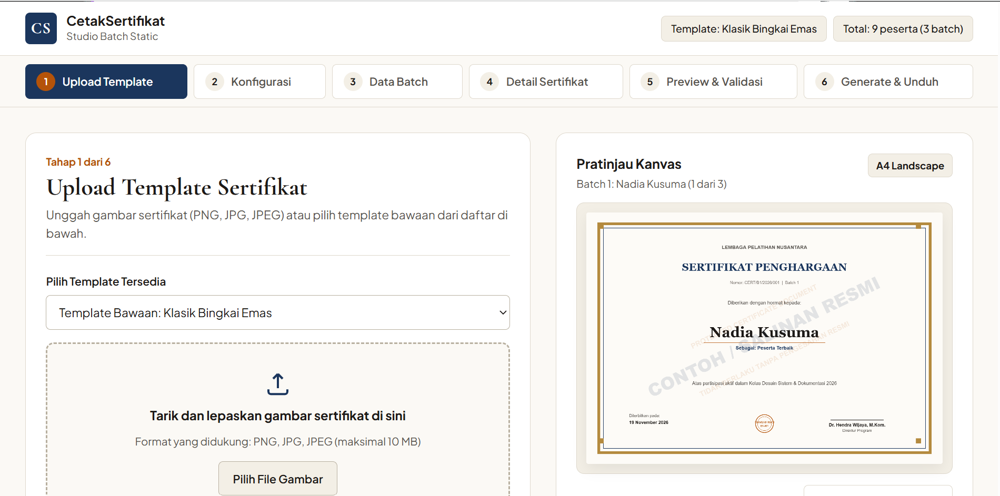

# 🎓 CetakSertifikat – Studio Batch Static

Aplikasi web sederhana untuk membuat sertifikat secara otomatis menggunakan template gambar dan data peserta berdasarkan batch.

Dibuat menggunakan **HTML, CSS, dan Vanilla JavaScript** tanpa backend maupun database. Semua proses dilakukan langsung melalui browser.



## ✨ Fitur Utama

- **Upload Template** – Mengunggah gambar sertifikat sendiri atau menggunakan template bawaan.
- **Pilihan Desain** – Memilih jenis dan desain sertifikat melalui dropdown.
- **Batch Management** – Mengelola peserta berdasarkan Batch 1, Batch 2, Batch 3, dan seterusnya.
- **Input Data** – Menambahkan peserta secara manual, melalui tabel, atau import CSV.
- **Pengaturan Sertifikat** – Mengatur nama lembaga, judul, tanggal, nomor sertifikat, dan tanda tangan.
- **Live Preview** – Melihat hasil sertifikat sebelum diunduh.
- **Generate Otomatis** – Membuat sertifikat untuk satu peserta, satu batch, atau seluruh batch.
- **Download** – Mengunduh sertifikat dalam format PNG atau JPG, termasuk ZIP untuk banyak sertifikat.
- **QR Code** – Menambahkan kode QR sebagai identitas sertifikat.

## 🔄 Alur Penggunaan

1. **Upload Template** – Pilih gambar sertifikat yang ingin digunakan.
2. **Pilih Desain** – Atur jenis sertifikat dan ukuran kertas.
3. **Input Peserta** – Masukkan data peserta dan kelompokkan berdasarkan batch.
4. **Atur Detail** – Sesuaikan nama, tanggal, nomor sertifikat, dan tanda tangan.
5. **Preview** – Periksa hasil sertifikat sebelum dibuat.
6. **Generate & Download** – Buat dan unduh sertifikat secara otomatis.

## 🛠️ Teknologi

| Teknologi | Kegunaan |
|---|---|
| HTML5 | Struktur halaman |
| CSS3 | Tampilan aplikasi |
| JavaScript | Logika aplikasi |
| Canvas API | Membuat gambar sertifikat |
| jsPDF | Export PDF (opsional) |
| JSZip | Download ZIP (opsional) |
| LocalStorage | Menyimpan data di browser |

## 📁 Struktur Folder

```text
generate-sertifikat/
│
├── index.html
├── styles.css
├── app.js
├── assets/
│   └── templates/
├── main.png
└── README.md
```

## 🚀 Cara Menjalankan

1. Clone repository:

```bash
git clone https://github.com/USERNAME/generate-sertifikat.git
```

2. Masuk ke folder project:

```bash
cd generate-sertifikat
```

3. Buka `index.html` menggunakan browser.

Atau jalankan menggunakan server lokal:

```bash
python -m http.server 8000
```

Kemudian buka `http://localhost:8000`.

## 🔒 Privasi

- Tidak membutuhkan backend atau database.
- Data peserta diproses langsung di browser.
- Tidak mengirim data peserta ke server eksternal.
- Data lokal dapat disimpan menggunakan browser.

## 📌 Catatan

Aplikasi ini dirancang untuk penggunaan lokal dan dapat dikembangkan lebih lanjut sesuai kebutuhan.

---

**CetakSertifikat** – Buat banyak sertifikat dengan lebih mudah dan praktis. 🎓